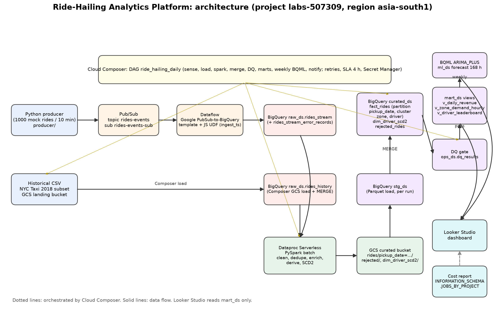

# Ride-Hailing Analytics Platform (capstone)

A daily analytics platform for a ride-hailing operator: operational metrics by 06:00, a 7-day (168-hour) demand forecast for the top ten pickup zones, an SCD Type 2 driver history, and data-quality gates so bad numbers never reach the dashboard. Built from the capstone brief (`05_Capstone_Project.docx`) on GCP project `labs-507309`, region `asia-south1` (configuration defaults, not proof that resources exist).

**Honest status:** all code, SQL, DAG, tests and documents exist and pass locally. **Nothing has been created, deployed or run in GCP yet**, so no cloud table, bucket or dashboard exists. The remaining items are cloud runs and three manual deliverables (Looker Studio link, cost screenshot, demo recording). See [docs/DELIVERABLES_CHECKLIST.md](docs/DELIVERABLES_CHECKLIST.md).



Diagram: [PNG](docs/architecture/diagrams/architecture.png), [PDF](docs/architecture/diagrams/architecture.pdf), editable source [architecture.mmd](docs/architecture/diagrams/architecture.mmd), regenerate with `python docs/architecture/diagrams/build_diagram.py`.

## Data flow
1. `producer/` publishes 1,000 mock rides over 10 minutes to Pub/Sub topic `rides-events` (dry run by default).
2. The Google-provided Dataflow **Pub/Sub Subscription to BigQuery** template (plus a small JS UDF that validates and adds `ingest_ts`) writes `raw_ds.rides_stream`; rejected messages go to `raw_ds.rides_stream_error_records`.
3. Composer loads the NYC Taxi 2018 CSV from GCS into `raw_ds.rides_history`.
4. A Dataproc Serverless PySpark batch reads both raw tables, cleans, deduplicates, enriches, derives columns, builds the SCD2 driver history and writes partitioned Parquet to the curated bucket.
5. Composer loads the Parquet into `stg_ds` and MERGEs into `curated_ds.fact_rides` (partitioned by `pickup_date`, clustered by `pickup_zone, driver_id`) and `curated_ds.dim_driver_scd2`.
6. SQL data-quality checks gate the run. On pass: `mart_ds` views are refreshed and, weekly, a BQML `ARIMA_PLUS` model forecasts the next 168 hours for the top ten zones (`ml_ds.zone_demand_forecast`).
7. Looker Studio reads `mart_ds`. A cost report reads `INFORMATION_SCHEMA.JOBS_BY_PROJECT`.

## Requirement map and deviations
| Brief | Where | Notes |
|---|---|---|
| Producer, topic `rides-events`, 9-field payload | [producer/](producer/README.md) | exactly 1,000 events / 600 s when run with `--publish --confirm-full-run`; dry run by default |
| Dataflow template to `raw_ds.rides_stream` | [ingestion/](ingestion/README.md) | subscription variant (durable), max 2 workers; adds `ingest_ts` through the UDF |
| History to `raw_ds.rides_history` | `dags/` (`load_history_to_raw` = `GCSToBigQueryOperator`, then `merge_history_to_raw`); `ingestion/historical.py` for manual loads | staging table then one delete-insert transaction, so reruns are safe; only 2018 rows are loaded |
| PySpark clean, dedupe, enrich, derive, SCD2 | [spark/](spark/README.md) | zones come from the TLC lookup CSV (no separate `dim_zone` table); driver snapshot has no producer yet |
| Parquet `gs://curated/rides/dt=...` | `gs://<curated>/curated/rides/pickup_date=YYYY-MM-DD/` | partition key is named `pickup_date` (same value as `dt`) so BigQuery can read it as the fact partition column |
| Fact, SCD2, marts, BQML | [sql/](sql/README.md) | native load plus MERGE (not BigLake); model trains on `mart_ds.v_zone_demand_hourly` |
| DAG `ride_hailing_daily` | [dags/](dags/README.md) | all ten tasks plus helper tasks; retries 2 with backoff, 4 h SLA, Secret Manager backend, 7-day on-demand backfill |
| `terraform/` or `bootstrap.sh` | [bootstrap.sh](bootstrap.sh) | dry run by default, idempotent, never deletes |
| Cost report | [sql/cost/](sql/cost) | daily bytes billed, expensive queries, budget check |
| Looker Studio, cost screenshot, demo | [docs/guides/](docs/guides) | manual steps with checklists |

## Run it (every cloud step needs your approval)
Local checks need no cloud access:
```powershell
python -m venv .venv; .\.venv\Scripts\Activate.ps1
pip install -r producer/requirements.txt -r ingestion/requirements.txt -r spark/requirements.txt sqlglot
python -m pytest tests -q
```
Cloud, in order (details in each folder's README and [docs/guides/gcp-resource-map.md](docs/guides/gcp-resource-map.md)):
1. `./bootstrap.sh` (dry run), review, then `./bootstrap.sh --apply --upload-code`. Add `--with-iam` only after reviewing the IAM list.
2. Put the zone lookup CSV and a NYC Taxi 2018 CSV in the landing bucket; optionally a driver snapshot.
3. Producer: `python -m producer --count 10` (dry run), then `--count 10 --duration-seconds 10 --publish`, then the full run.
4. Dataflow: `python -m ingestion.dataflow` prints the launch command; run it, later cancel the job.
5. Composer: create the smallest environment, set the environment variables, upload `dags/` and `sql/` ([dags/README.md](dags/README.md)), run `ride_hailing_daily` for one past date.
6. Looker Studio and the cost screenshot: [docs/guides/dashboard.md](docs/guides/dashboard.md). Demo: [docs/guides/demo-script.md](docs/guides/demo-script.md).

## Cost estimate
Estimates only; check the Google Cloud Pricing Calculator before running. Guardrails built in: per-query cap `maximum_bytes_billed` = 10 GB (`RH_MAX_BYTES_BILLED`), Dataflow max 2 workers, Serverless Spark (no clusters), GCS lifecycle deleting `raw/` after 14 days, budget alerts at 50 and 100 USD (printed by `bootstrap.sh`, created by you).
| Service | Driver | Expectation |
|---|---|---|
| Cloud Composer | environment hours (smallest size) | by far the largest cost; create it late, delete it after the demo |
| Dataflow | job hours x up to 2 workers | the streaming job runs until cancelled: cancel it after the 1,000-event test |
| Dataproc Serverless | batch vCPU/memory time | one small batch per run, minutes |
| BigQuery | bytes billed (capped) | the sample data is small; the 10 GB cap bounds every query. BQML ARIMA_PLUS training is billable and off until `rh_enable_bqml_retrain` is `true` |
| Pub/Sub, GCS | 1,000 messages, MBs of Parquet | negligible |

## Folders
`producer/`, `ingestion/` (Dataflow helper, UDF, historical loader), `spark/` (PySpark), `sql/` (DDL, MERGE, marts, BQML, DQ, cost), `dags/` (Composer), `tests/`, `docs/` (requirements, architecture, contracts, guides), `bootstrap.sh`, `.github/agents/` (the seven Copilot agents that built this).

## Known gaps and decisions needed
- Business time zone (UTC or IST): set the same value in Spark `--timezone`, SQL `@business_tz` and DAG `RH_BUSINESS_TZ`.
- Driver snapshot and zone lookup files need an owner and a location; without a snapshot the SCD2 steps are skipped.
- Local Parquet tests for Spark are skipped on Windows without Hadoop `winutils`; run them in Cloud Shell or CI.
- Anything marked "not verified" in the folder READMEs (Airflow provider arguments, BigQuery acceptance of the scripts, ARIMA_PLUS in `asia-south1`, Dataproc command flags) needs a real run.
