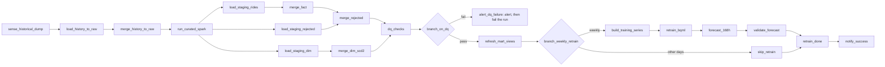

# Composer DAG: `ride_hailing_daily`

Status: written and tested **locally only, without Airflow**. Nothing has been deployed, triggered or run in the cloud. Compatibility with the real Airflow and provider APIs is **not verified** (see "Validation").

## What it does

The ten requested tasks are all present. Extra tasks, and why: `merge_history_to_raw` (idempotent insert after the GCS load), `load_staging_*` (the merges read staging tables filled from the Spark Parquet), `merge_rejected` (the DQ reconciliation reads rejected rides), `alert_dq_failure` (failure path), `branch_weekly_retrain`, `skip_retrain`, `build_training_series`, `forecast_168h`, `validate_forecast`, `retrain_done` (weekly branch and join).

Order differs from the request in one place on purpose: `dq_checks` and `branch_on_dq` run **before** `refresh_mart_views` and the forecast, so bad data blocks marts, the model and the success message. The fact table is already merged by then (the DQ SQL checks curated data); marts are views over it. A failed gate is therefore a stop-and-fix signal, not a rollback.

| Task | Operator | Runs |
|---|---|---|
| `sense_historical_dump` | `GCSObjectExistenceSensor` (reschedule) | waits for `gs://<landing>/<historical object>` |
| `load_history_to_raw` | `GCSToBigQueryOperator` | CSV into `raw_ds.rides_history_stg` (replaced on every run) |
| `merge_history_to_raw` | `BigQueryInsertJobOperator` | one transaction: delete this source file's rows, insert the 2018 rows into `raw_ds.rides_history` |
| `run_curated_spark` | `DataprocCreateBatchOperator` | `spark/run_job.py` with the window and run id |
| `load_staging_*` | `PythonOperator` | Parquet of the window's folders into `stg_ds.*` (replaces the table) |
| `merge_fact`, `merge_rejected`, `merge_dim_scd2` | `BigQueryInsertJobOperator` | `sql/merge/*.sql` |
| `dq_checks` | `PythonOperator` | the six `sql/data_quality/*.sql`, rows stored in `ops_ds.dq_results`, compact summary to XCom |
| `branch_on_dq` | `BranchPythonOperator` | FAIL, missing or empty summary -> `alert_dq_failure`; else `refresh_mart_views` |
| `refresh_mart_views` | `BigQueryInsertJobOperator` | `CREATE OR REPLACE VIEW` for the four mart views (also validates them against current tables) |
| `branch_weekly_retrain` | `BranchPythonOperator` | retrain only on the weekly day, when enabled |
| `build_training_series`, `retrain_bqml`, `forecast_168h`, `validate_forecast` | BigQuery / Python | `sql/bqml/01..04` |
| `notify_success` | `PythonOperator` | success message; refuses to run unless the DQ summary has no failures |

## Configuration
Settings are environment variables on the Composer environment ([config/environment.example.env](config/environment.example.env)); the DAG fails to import with a list of every missing or invalid setting. Required: `RH_LANDING_BUCKET`, `RH_CURATED_BUCKET`, `RH_ARTIFACTS_BUCKET`, `RH_SPARK_SERVICE_ACCOUNT`. Everything else has a default (project `labs-507309`, region `asia-south1`, lookback 3 days).

| Item | Where | Default |
|---|---|---|
| Schedule | `RH_SCHEDULE_CRON`, `RH_SCHEDULE_TZ` | `0 1 * * *`, `Asia/Kolkata` (runs 01:00 for the previous day) |
| Business time zone | `RH_BUSINESS_TZ` | `UTC`. Must equal the Spark `--timezone` and the SQL `@business_tz`. Orchestrator decision D-006 (UTC or IST) is still open. |
| Retrain switch | Airflow Variable `rh_enable_bqml_retrain` | `false`: **no model training happens until you set it to `true`** |
| Retrain day | `RH_RETRAIN_WEEKDAY` (Monday = 0) | 0 |
| Run parameters | trigger `conf` | `backfill_days` 0..7, `force_retrain` bool, `historical_object` path override |
| Alert connection | Airflow connection `rh_alert_webhook` (Secret Manager) | optional |
| Alert e-mail | `RH_ALERT_EMAILS` | none (needs Composer e-mail/SendGrid configuration) |

Time and windows: `ds` is the business day being processed. Normal run: pickup dates `ds - lookback` .. `ds`, identical in Spark and in the merges (same macro). `run_id = <ds>-<ts_nodash>` is stable across retries and clears, valid for Spark and BigQuery.

Where files go: DAG and `common/` into the DAGs folder; the repo's `sql/` folder into the environment bucket under `data/sql/` (mounted at `/home/airflow/gcs/data/sql`, read through Jinja `include` and by the DQ task).

## Secret Manager
Use Composer's supported Secret Manager backend ([config/secret_manager.example.md](config/secret_manager.example.md)): connections are served from secrets named `airflow-connections-<id>`. The only connection the DAG reads is the optional alert webhook; Google access uses the environment's service account. No secrets are in code, XCom or logs; alert text and error messages pass through a redactor (tests cover API keys, tokens, passwords, bearer headers, URLs with credentials, private keys).

## Notifications
- **Task failure, DAG failure, SLA miss:** callbacks log a compact, redacted message and post it to the webhook connection when it exists; e-mail is sent by Airflow when `RH_ALERT_EMAILS` is set.
- **Data-quality failure:** `alert_dq_failure` sends the failed check ids and where to look (`ops_ds.dq_results`), then fails the run so the failure is visible in the UI and in the DAG-failure alert. Forecast validation failures do the same.
- **Success:** `notify_success` sends one short message after the DQ gate (and the forecast validation on retrain days).
Alert sending never raises, so an unreachable webhook cannot hide the original failure. XCom carries only the DQ summary: counts and up to 20 check ids.

## Retries, timeouts, SLA
- `retries=2` with exponential backoff (5 min, about 10 min, capped at 30) on all tasks except `sense_historical_dump` (its 1 h timeout is the waiting budget) and `alert_dq_failure` (deterministic). Broken configuration (missing SQL file or parameter, no Spark output) fails without retries.
- Per attempt: 45 min default, Spark 2 h 15, retrain 90 min. `dagrun_timeout` 5 h. SLA 4 h per task from the scheduled run time with an SLA-miss alert. The SLA is a target; Airflow only reports misses.
- The DAG is created paused; `catchup=False`, one active run, `depends_on_past=False`.

## Idempotency and reruns
Every task can be cleared and rerun, or the whole run retriggered. Spark replaces its window partitions; staging tables are replaced by each load; merges are idempotent and assert their inputs; the historical load replaces one source file's rows; views are `CREATE OR REPLACE`; forecast and eligibility are delete-then-insert per `as_of_ts`. The Dataproc batch id includes the run time and the try number, so a rerun never reuses a finished batch.

## Backfill (last seven days)
One run that recomputes seven pickup dates: trigger with `{"backfill_days": 7}` and the run date as logical date (the last date to recompute):
```powershell
gcloud composer environments run <ENV> --location asia-south1 dags trigger -- ride_hailing_daily -e 2026-10-14 -c '{"backfill_days": 7}'
```
Backfill runs do not retrain the model unless `force_retrain` is true. Alternatively use `airflow dags backfill -s <start> -e <end>` for one run per day (each uses the normal window). Not verified.

## Validation
**Local (done, no cloud, no Airflow):** `python -m pytest tests/dags -q` runs the DAG file against a small Airflow stand-in (`tests/dags/airflow_stub.py`) and covers settings validation, window and backfill logic, the task graph and edges, trigger rules, retries, SLA and timeouts, branch decisions (DQ and weekly retrain), DQ summary size, staging layout, alert redaction, and interface checks against the real files: SQL `@parameters` of every file, the Spark job's own argument parser, the ingestion column list and the Spark output folders. `tests/dags/test_dags_airflow_import.py` uses the real `DagBag` and is **skipped** where Airflow is not installed. The stand-in is not Airflow: operator argument names, template rendering and provider behaviour are unproven.

**Cloud verification still required (needs your approval, none done):**
1. Import in the real Composer environment: no DAG import errors; run the DagBag test in an image matching the Composer Airflow and provider versions.
2. Provider details: `DataprocCreateBatchOperator` arguments and batch id rules, `BigQueryInsertJobOperator` with `` from `template_searchpath`, `GCSObjectExistenceSensor` options (`soft_fail`, `mode`), `sla` and `sla_miss_callback` on the installed version, `ti.try_number` rendering.
3. BigQuery: that the merge and BQML scripts with `ASSERT` are accepted when sent as one query job with named parameters; `GCSToBigQueryOperator` argument names on the installed provider. The historical load does not verify the CSV header (the ingestion CLI does).
4. Secret Manager backend configured; connection read once; alert delivered.
5. A small-window dry run with the DAG paused-by-default, then one real run of a past date; compare Spark output, staging, curated rows and DQ rows. Measure end-to-end time against the 4 h target.
6. Backfill run with `backfill_days=7` and a second run to prove reruns change nothing.
7. Retrain run (set the Variable to `true` after approving the BQML cost), forecast validation passes.

## Deployment runbook (run only after approval; commands are untested)
Prerequisites, each approved separately: BigQuery DDL applied (`sql/ddl/*`, in order), Spark `run_job.py` and `ridespark.zip` uploaded to `gs://<artifacts>/spark/code/`, zone lookup CSV in the landing bucket, IAM for the environment service account (BigQuery data editor on the datasets, job user, Dataproc batch creation, service account user on the Spark account, read on landing, read/write on curated, Secret Manager accessor on the alert secret), optional Secret Manager backend.
```powershell
$env_name = "<ENV>"; $loc = "asia-south1"
# 1. Environment settings (placeholders only)
gcloud composer environments update $env_name --location $loc --update-env-variables="RH_LANDING_BUCKET=...,RH_CURATED_BUCKET=...,RH_ARTIFACTS_BUCKET=...,RH_SPARK_SERVICE_ACCOUNT=..."
# 2. SQL for the merges, marts, DQ and forecast
gcloud composer environments storage data import --environment $env_name --location $loc --source sql --destination sql
# 3. DAG and helpers (the DAG is created paused)
gcloud composer environments storage dags import --environment $env_name --location $loc --source dags\ride_hailing_daily.py
gcloud composer environments storage dags import --environment $env_name --location $loc --source dags\common --destination common
gcloud composer environments storage dags import --environment $env_name --location $loc --source dags\.airflowignore
# 4. Check the import
gcloud composer environments run $env_name --location $loc dags list-import-errors
# 5. Keep retraining off, then unpause only when you are ready for billable runs
gcloud composer environments run $env_name --location $loc variables set -- rh_enable_bqml_retrain false
gcloud composer environments run $env_name --location $loc dags unpause -- ride_hailing_daily
```
Rollback: pause the DAG (`dags pause -- ride_hailing_daily`), remove the files from the DAGs folder; merged data is idempotent to rerun and is never deleted by the DAG outside its window.

## Troubleshooting
| Symptom | Likely cause and fix |
|---|---|
| DAG missing, "Broken DAG: RH_... is not set" | set the listed environment variables; the message names each one |
| `sense_historical_dump` times out | object not in the landing bucket at the expected path; check `RH_HISTORICAL_OBJECT_TEMPLATE` or trigger with `historical_object`; set `RH_HISTORICAL_DUMP_REQUIRED=false` after the one-off load |
| `load_history_to_raw`: "no 2018 pickups" | wrong file; the capstone needs NYC Taxi 2018 and no other year is substituted |
| `run_curated_spark` fails | open the batch in Dataproc Serverless; Spark exit codes are listed in `spark/README.md` (3 missing dimension, 4 schema mismatch, 5 driver history) |
| `load_staging_rides`: "No Spark output under gs://..." | Spark wrote elsewhere or produced nothing for the window; check `RH_CURATED_*` against Spark `--output-path` |
| merge `ASSERT` message | staging was empty, mixed or outside the window: rerun from `load_staging_*` |
| `dq_checks`: "SQL file not found" | upload `sql/` to the environment bucket under `data/sql/` |
| Run failed at `alert_dq_failure` | intended: read the failed check ids in the message and `ops_ds.dq_results`; fix the data, then clear `run_curated_spark` and downstream |
| `merge_dim_scd2` and `load_staging_dim` skipped | `RH_DRIVER_SNAPSHOT_URI` not set: no new driver snapshot, history unchanged |
| `branch_weekly_retrain` always skips | Variable `rh_enable_bqml_retrain` is not `true`, or it is not the retrain weekday |
| No alert in the webhook | connection `rh_alert_webhook` missing or secret not readable; the alert is still in the task log |

## Assumptions and open items
- Composer 2 with Airflow 2.4 or newer and the Google provider (`schedule=`, `EmptyOperator`, `Param`).
- The historical file is a dated drop (`historical/<ds>/...2018...csv`); adjust the template to your real object naming.
- Spark's driver snapshot and zone lookup have no owner yet (see `spark/README.md`); the SCD2 steps skip when no snapshot is configured.
- Dashboards see curated data as soon as it is merged; the DQ gate protects marts, the model and notifications, not the curated tables.
- Contract 04 (task ids, `rh_*` names) is out of date; this DAG follows the later contracts of the Spark and SQL agents.
