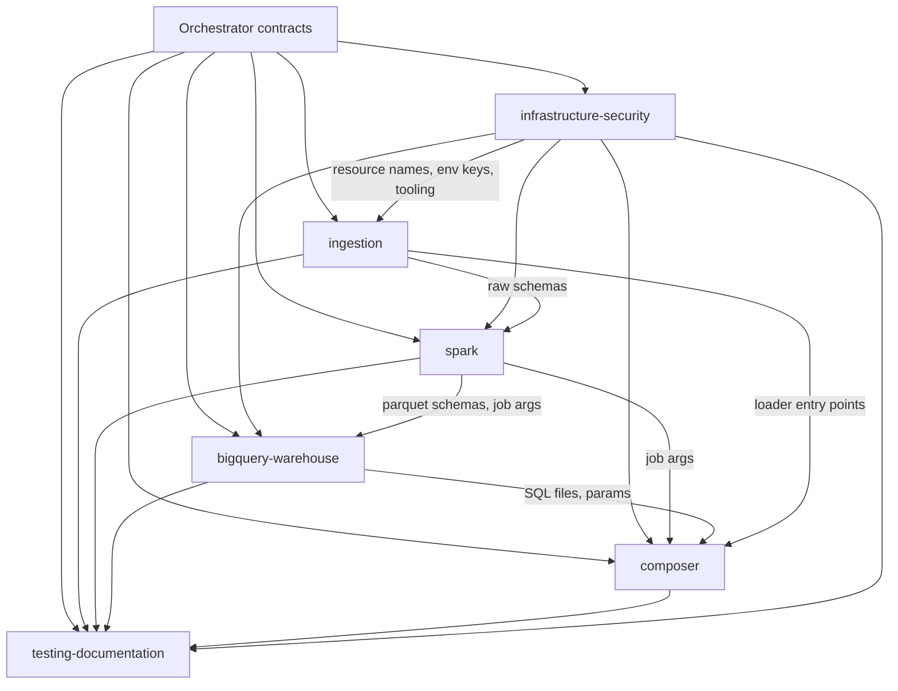

# Architecture Overview (v0.1.0, draft)

Diagram source: [diagrams/architecture.mmd](diagrams/architecture.mmd). PNG/PDF export is pending (REQ-025).

## Data flow
1. The Python producer publishes JSON events to Pub/Sub `rh-ride-events` (dry-run by default).
2. Dataflow (streaming) validates structure and writes to `rh_raw.ride_events_raw` and `rh_raw.driver_events_raw`. Invalid messages go to `rh_raw.rejected_events`.
3. Historical CSVs in the GCS landing bucket are loaded by Composer into `rh_raw.hist_*_raw`.
4. Dataproc Serverless runs PySpark: dedup, validation, ride-state merge, SCD2 driver changes. It writes Parquet to the curated bucket.
5. Composer loads Parquet into `rh_staging`, then MERGEs into `rh_curated`.
6. DQ SQL gates run. Only on pass do marts refresh and the ARIMA_PLUS model retrain and forecast.
7. Looker Studio reads `rh_marts` views only.

## Where bad data is stopped
| Layer | Mechanism |
|---|---|
| Dataflow | Structural validation, rejects table |
| Spark | Row-level business rules R-xxx / D-xxx, quarantine to `rejected_records` |
| BigQuery | Batch-level checks Q-001..Q-010 in `rh_ops.dq_results`; ERROR severity fails the DAG before marts and forecast run |
| Marts | Views read `rh_curated` and `rh_ml` only, never `rh_raw` |

## SLA (REQ-001)
DAG starts at 01:00 IST for the previous IST business day. Budget: load 10 min, Spark 30 min, MERGE 10 min, DQ 10 min, ML 20 min. That is about 80 min, leaving buffer. An Airflow SLA miss alert fires at 05:30 IST.

## Directory layout
```
.github/agents/                 orchestrator
docs/requirements/              orchestrator
docs/DELIVERABLES_CHECKLIST.md  orchestrator
docs/architecture/              orchestrator (overview, order, decisions, briefs, diagrams/)
docs/contracts/                 orchestrator
docs/acceptance/                orchestrator
docs/guides/ docs/runbooks/ docs/evidence/   testing-documentation-agent
src/ingestion/producer/ dataflow/ batch/     ingestion-agent
src/spark/jobs/ transforms/ scd2/            spark-processing-agent
src/warehouse/ sql/ddl merge marts ml dq cost  bigquery-warehouse-agent
dags/ dags/common/              composer-orchestration-agent
infra/terraform/ scripts/ config/env/ .github/workflows/   infrastructure-security-agent
config/ingestion|spark|warehouse|composer/  respective agent
tests/<component>/              respective agent
tests/integration/ e2e/ fixtures/ conftest.py   testing-documentation-agent
```

## Dependency map


## Interface hops checked at acceptance
| Hop | Producer | Consumer | Contract |
|---|---|---|---|
| H1 | producer events | Dataflow validation | 01 |
| H2 | Dataflow output | raw DDL | 01, 03 |
| H3 | raw tables | Spark readers | 02, 03 |
| H4 | Spark Parquet | staging DDL and MERGE | 02, 03 |
| H5 | curated tables | marts, ML, DQ SQL | 03 |
| H6 | Composer tasks | Spark args, SQL params, loaders | 04 |
| H7 | config keys | `.env.example`, Terraform outputs | 00 |

## Open assumptions
See [decisions.md](decisions.md), entries marked ASSUMPTION. They await user confirmation before Stage B starts.
